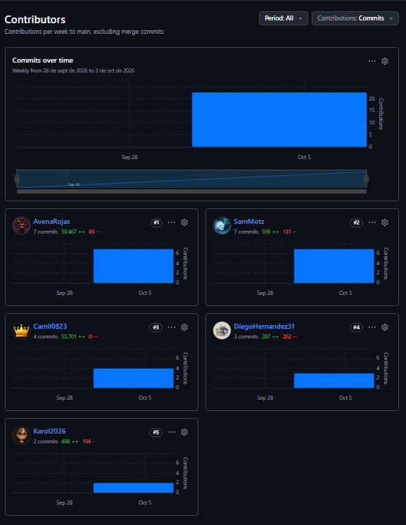

## Trazabilidad del desarrollo

> **Alcance y método.** Esta sección solo incluye información verificable: (1) el historial de Git de la rama `main` (43 commits, del 9 al 10 de octubre de 2026) y (2) el registro de una sesión de trabajo con Claude (Anthropic) del 10 de octubre de 2026. Lo que no se pudo verificar está marcado como *pendiente de confirmar*.

### 1. Punto de partida

- El 9 de octubre de 2026 se crea el esqueleto del proyecto (`922e3a7`, "Game Skeleton - Project Dancin' Potato"): configuración base de Godot (`project.godot`, `.gitignore`, `.gitattributes`, `.editorconfig`, `icon.svg`) y carpetas vacías con `placeholder.keep` (`assets/audios`, `assets/fonts`, `assets/sprites`, `resources`, `scenes/characters`).
- Mismo día se agrega el README inicial (`9f59daf`). La descripción del repositorio en GitHub es "GameHub-Game".
- Motor: Godot 4.8 (dev7), según la consola del editor.
- Autores de commits en `main`: Camil0823 (10), SamMotz (9), Andrés Rojas (7), Diego Hernández (7), AvenaRojas (6), DiegoH (2), Karol (2).

### 2. Hitos principales (orden cronológico)

| Fecha | Hito | Evidencia en Git |
|---|---|---|
| 09/10/2026 | Esqueleto del proyecto | `922e3a7` |
| 09/10/2026 | Movimiento del jugador y balas (escenas `Jhon_Pick`, `Debug_Level`, `bullet`, `weapon`; scripts `player.gd`, `bullet.gd`, `cameraPlayer.gd`) | `5064a63`, PR #1 |
| 09/10/2026 | Primer mapa (`papa_calle`) y `Level_1` | `65d39c6`, `cd21988`, PR #2 y #3 |
| 09/10/2026 | Modelos 3D del perro (Pug) y de Jhon Pick | `df34cd8` |
| 09/10/2026 | Música `Dog_Extermination.ogg` | `c4b4902`, PR #4 |
| 09/10/2026 | Mapa mejorado (`papa_calle_completo`, con `generar_mapa.py` y `generar_texturas.py`) | `8192ef0`, PR #5 |
| 09/10/2026 | Entidad enemigo (`enemy.tscn`, `enemy.gd`) | `b65ee28`, PR #6 |
| 10/10/2026 | Modelos de armas (Arpa_Emisora, Super_Laser) | `3ea4c31`, PR #7 |
| 10/10/2026 | Menú de inicio y opciones; luego créditos | `d85338a`, PR #8; `789f096`, PR #12 |
| 10/10/2026 | Colisiones y contador de muertes (spawner y `LevelManager`), revertido después | `2711577`, PR #9; `ffc8da2`, PR #10 |
| 10/10/2026 | Barra de energía (assets Under/Progress/Over) y `beat_timer` | `192d786`, PR #11 |
| 10/10/2026 | Corrección del spawn de enemigos (`enemy_spawner`, `LevelManager`, cambios en `RhythmManager.gd`) | `5c13463`, PR #13 |
| 10/10/2026 | Build jugable parte 1 (`export_presets.cfg`, `Cursor.png`) | `329cf4f`, PR #14 |
| 10/10/2026 | Personaje 3D y arma 1 (Bone_Revolver, Overcharge_Scattergun), cambios en `player.gd`, resolución de conflictos de merge y cambio del modelo de enemigo | `3bcb090`, `d88ab6f`, `1842fcc`, `af32ed5`, `abf9177`, `f8ad14e`, `5cca442`; PR #15 y #16 |

### 3. Herramientas de IA utilizadas

- **Claude (Anthropic)**, mediante chat, en una sesión de trabajo del 10/10/2026 (capturas del editor con hora local entre 1:59 a. m. y 6:15 a. m., y una operación de Git a las 6:36 a. m., UTC−5). También asistió en la redacción de esta sección a partir del historial de Git.
- Asistente LLM (IA Conversacional, Gemini) para depuración técnica, diseño de arquitectura de código en GDScript y resolución de problemas de control de versiones.
- *(Pendiente de confirmar: otras herramientas de IA usadas por otros integrantes. Este documento no tiene evidencia sobre ellas.)*
- Alcance de la evidencia: la conversación con Claude y con Gemini documentan el trabajo sobre el jugador, el ritmo, los enemigos, las armas, las balas, las cámaras y Git. No cubre el trabajo de mapa, modelos 3D ni menús.

### 4. Ejemplos de tareas donde la IA fue relevante

Código de Claude que aparece integrado en archivos que el equipo compartió durante la sesión: roll con invulnerabilidad, soltar/lanzar/recoger armas, golpe cuerpo a cuerpo sincronizado con el ritmo, `recibir_dano` del jugador y el sistema de cámaras.

1. **Apuntado con el mouse.** Se corrigió una rotación en ejes no deseados (`look_at` sobre el sprite) y se eliminó una segunda llamada a `move_and_slide()` por frame.
2. **Fallos de ritmo intermitentes.** Se agregó instrumentación (desfase con signo respecto al beat y motivo del fallo) para distinguir entre error de ritmo, desfase de BPM y colisiones. El equipo ejecutó la prueba y compartió los logs.
3. **Mecánicas del jugador.** Roll con bonus de energía en beat, `DroppedWeapon` (soltar, lanzar con daño y recoger/intercambiar armas) y melee sin arma sujeto al ritmo.
4. **Enemigos.** Detección con dos radios (histéresis) y persecución. Se detectaron dos errores: el jugador no estaba en el grupo `player` y `take_damage(int)` truncaba el daño `0.5` a `0`. Luego se conectó el daño del enemigo al jugador.
5. **Interfaz.** Propuestas de un péndulo para el `BeatTimer` y de una barra de energía con `TextureProgressBar` (suavizado, barra de retraso, color por nivel). *(Pendiente de confirmar: si se adoptaron en el proyecto.)*
6. **Cámaras.** Reversión de un cambio de cámara con mouse capturado, sistema de tres vistas (isométrica, shooter fija, shooter libre) y diagnóstico de dos problemas: vibración (cámara en `_process` y jugador en física) y disparos a mitad de animación (orden de `shoot()` y `_on_shoot_pose()`, y dirección tomada del `Muzzle`).
7. **Cursor.** Explicación del hotspot del cursor personalizado (imagen de 80×80 px, centro en 40,40) y alternativa con mira propia.
8. **Git.** Diagnóstico del rechazo de GitHub (`build_Windows/Project Dancin' Potato.exe` de 118,48 MB, sobre el límite de 100 MB) y procedimiento para reescribir los commits locales sin el ejecutable, además de la distribución de builds por Release o Drive.

### 5. Intervenciones humanas importantes

- **Decisiones de diseño:** cambiar el salto por un roll; clic derecho para soltar, lanzar, recoger e intercambiar armas; melee sin arma que siga el mismo ritmo que las balas; volver a la cámara anterior tras el cambio de un compañero; pasar de una a tres cámaras; ocultar el mouse real en las vistas 1 y 2.
- **Pruebas y reporte de resultados:** logs de ritmo con `desfase` y `tol`, "el jugador no recibe daño", "la cámara vibra", "dispara a mitad de animación" y "el hotspot sigue sin funcionar con 40 ni con 39".
- **Ajustes de balance sobre lo propuesto** (verificados en los archivos y logs compartidos):

| Parámetro | Propuesto | Valor visto |
|---|---|---|
| `ROLL_ENERGY_BONUS` | 3.0 | 9.0 |
| `MELEE_DAMAGE` | 15.0 | 0.5, luego 1.0 |
| `MELEE_COOLDOWN` | 0.4 | 0.15 |
| `tolerancia` (ventana de beat) | 0.144 | 0.125 (visible en los logs) |
| Offset de la cámara isométrica | (0, 3, 5) | (0, 6, 6) |

- **Trabajo de equipo en Git:** 16 pull requests numerados (#1 a #16), reversión del commit "AddCollisionsAndDieCounter" (`ffc8da2`) y resolución manual de conflictos de merge en `player.gd` (commits de SamMotz).
- **Bloqueo de GitHub:** dos intentos de push fallaron con el mismo error por el `.exe`. Después, el historial de `main` muestra "Playable build part 1" (`329cf4f`) sin ejecutables ni `.rar`.

### 6. Limitaciones y pendientes finales

- **Sin confirmar al cierre de la sesión:** las correcciones de vibración de cámara y de disparo a mitad de animación (interpolación de física activada, orden de la cámara respecto al jugador, `weapon.shoot(direction)` en todas las armas, mira propia con `Mouse Filter: Ignore`).
- **Cursor:** el hotspot seguía sin funcionar según el último reporte.
- **Cámara libre:** no detecta paredes (se propuso `SpringArm3D`, no integrado).
- **Disparos:** las balas solo viajan en horizontal; no hay apuntado vertical.
- **Enemigos:** persiguen en línea recta, sin navegación (`NavigationAgent3D`) ni línea de vista.
- **Balance:** el melee en beat puede recuperar energía muy por encima del drenado base, y cada enemigo en contacto quita 10 de energía por segundo. Hace falta ajustarlo con pruebas de juego.
- **`bullet.gd`:** cualquier choque con un cuerpo sin `take_damage` cuenta como fallo, incluido el propio jugador.
- **Repositorio:**
  - `main` contiene un archivo temporal (`scenes/levels/Debug_Level.tscn9719503024.tmp`) que debería eliminarse.
  - El `.gitignore` solo excluye `/exports/`, `/builds/` y `/bin/`. Falta `build_Windows/` (y `*.tmp`) para evitar que el ejecutable vuelva a colarse en un commit.
- **No verificado:** qué cambios de la sesión con Claude (cámaras de tres vistas, ajuste del disparo) ya están commiteados en `main`. No se auditó el contenido de los commits línea por línea.

